<h1>Diagrama entidad-relación SOE Latam</h1>

<style>
#diagrama-de-relaciones-ii---schedules--pickups--deliveries + pre svg {
    max-width: 400px !important;
}
#diagrama-de-relaciones-viv---warehouses + pre svg {
    max-width: 400px !important;
}
</style>

- [Diagrama de relaciones I - Locations](#diagrama-de-relaciones-i---locations)
- [Diagrama de relaciones II - Distributors](#diagrama-de-relaciones-ii---distributors)
- [Diagrama de relaciones III - Users](#diagrama-de-relaciones-iii---users)
- [Diagrama de relaciones IV - Equipments](#diagrama-de-relaciones-iv---equipments)
- [Diagrama de relaciones V - Installations](#diagrama-de-relaciones-v---installations)
- [Diagrama de relaciones VI - Warranties](#diagrama-de-relaciones-vi---warranties)
- [Tablas con atributos](#tablas-con-atributos)
  - [COUNTRIES](#countries)
  - [STATES](#states)
  - [CITIES](#cities)
  - [ADDRESSES](#addresses)
  - [SITES](#sites)
  - [DISTRIBUTORS](#distributors)
  - [DISTRIBUTORS BRANDS](#distributors-brands)
  - [DISTRIBUTORS EMAILS](#distributors-emails)
  - [DISTRIBUTORS PHONES](#distributors-phones)
  - [DISTRIBUTORS ALIGNERS](#distributors-aligners)
  - [CONTACTS](#contacts)
  - [DISTRIBUTORS LISTS](#distributors-lists)
  - [LISTS](#lists)
  - [USERS LISTS](#users-lists)
  - [CLIENTS](#clients)
  - [USERS](#users)
  - [USERS GROUPS](#users-groups)
  - [GROUPS](#groups)
  - [PERMISSIONS](#permissions)
  - [MODULES](#modules)
  - [BRANDS](#brands)
  - [CATEGORIES](#categories)
  - [EQUIPMENTS](#equipments)
  - [PARTS](#parts)
  - [INSTALLATIONS](#installations)
  - [REASONS](#reasons)
  - [WARRANTIES](#warranties)
  - [INSTALLATIONS FILES](#installations-files)
  - [SPECIFICATIONS](#specifications)
  - [EQUIPMENTS FILES](#equipments-files)
  - [MANUALS TYPES](#manuals-types)
  - [MANUALS](#manuals)
  - [MANUALS FILES](#manuals-files)
  - [WARRANTIES REASONS](#warranties-reasons)
  - [WARRANTIES WCOS](#warranties-wcos)
  - [WARRANTIES FILES](#warranties-files)

<div class="page"/>

## Diagrama de relaciones I - Locations

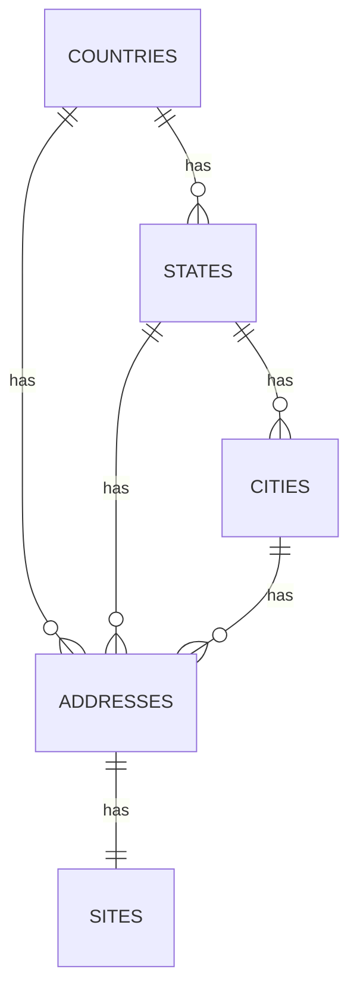

<div class="page"/>

## Diagrama de relaciones II - Distributors

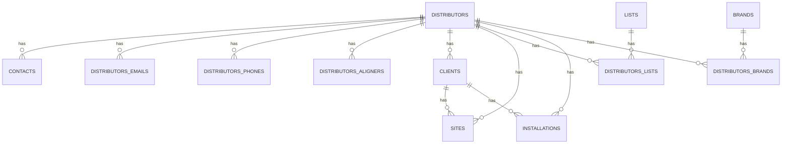

<div class="page"/>

## Diagrama de relaciones III - Users

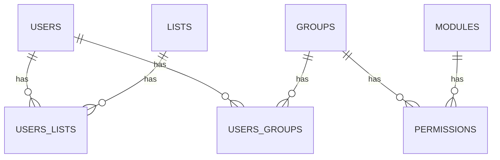

<div class="page"/>

## Diagrama de relaciones IV - Equipments

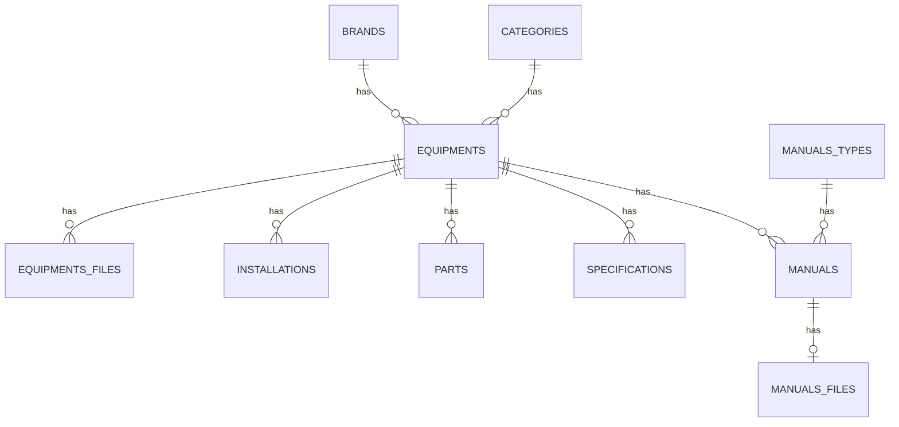

<div class="page" />

## Diagrama de relaciones V - Installations

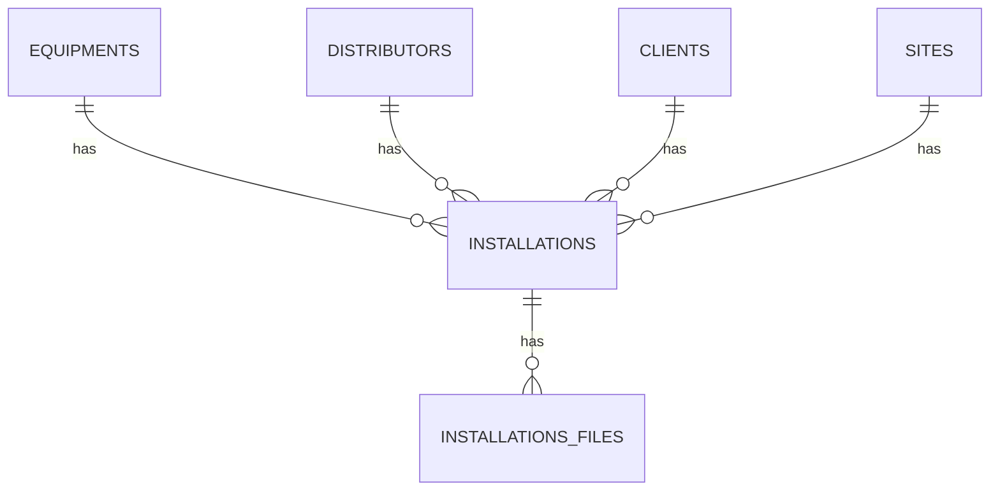

<div class="page"/>

## Diagrama de relaciones VI - Warranties

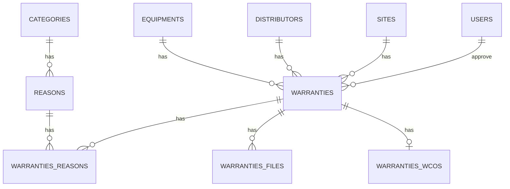

<div class="page" />

## Tablas con atributos

### COUNTRIES

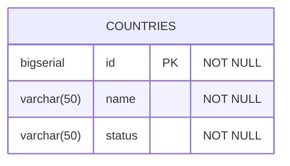

<div class="page"/>

### STATES

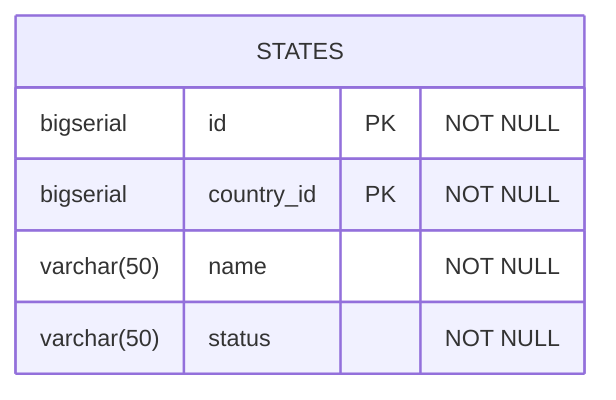

<div class="page" />

### CITIES

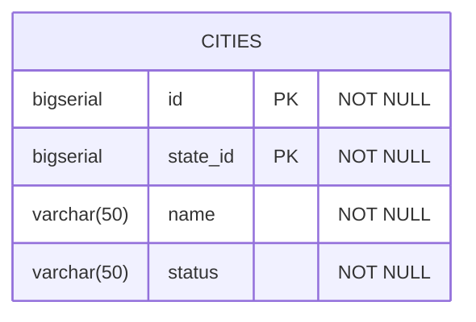

<div class="page" />

### ADDRESSES

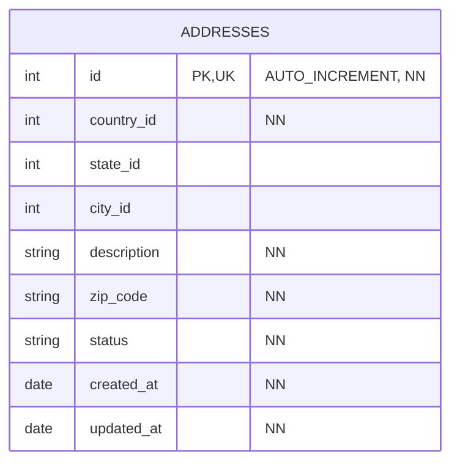

<div class="page" />

### SITES

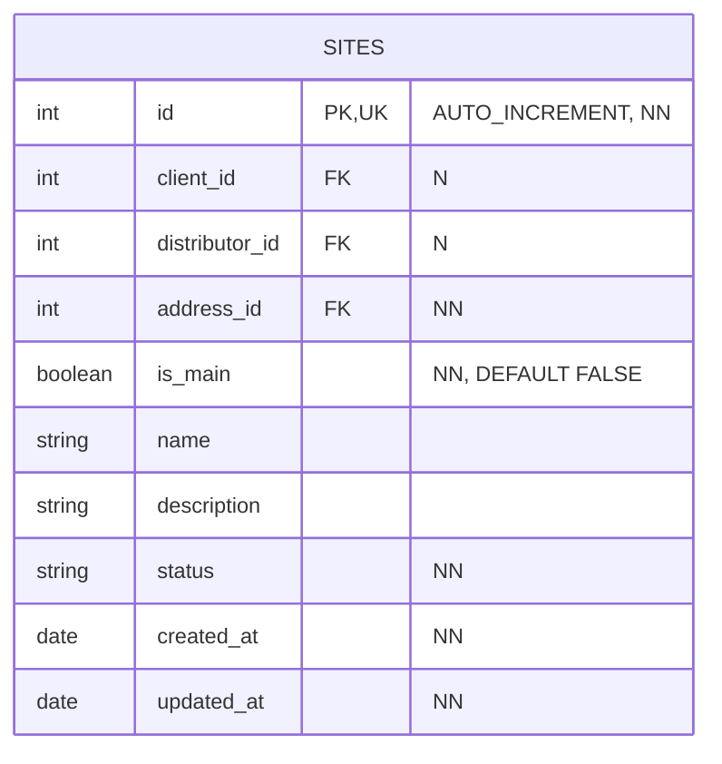

<div class="page" />

### DISTRIBUTORS

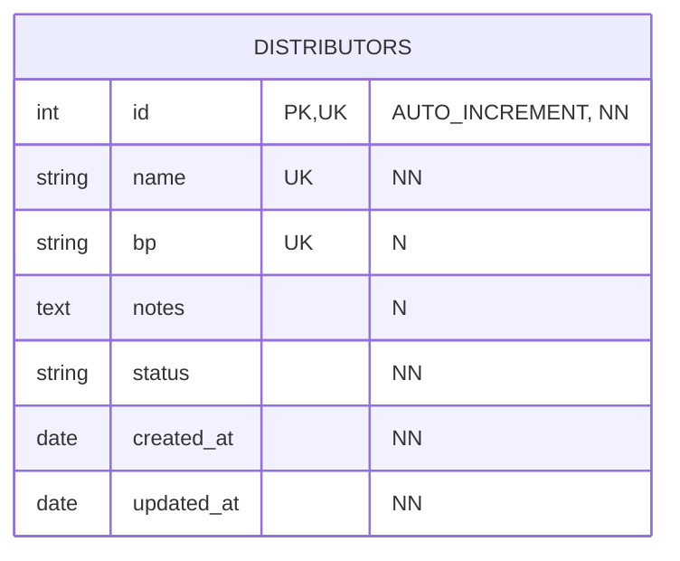

<div class="page" />

### DISTRIBUTORS BRANDS

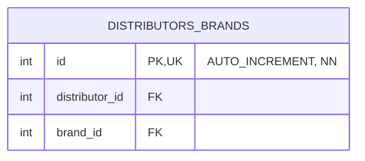

<div class="page" />

### DISTRIBUTORS EMAILS


<div class="page" />

### DISTRIBUTORS PHONES


<div class="page" />

### DISTRIBUTORS ALIGNERS

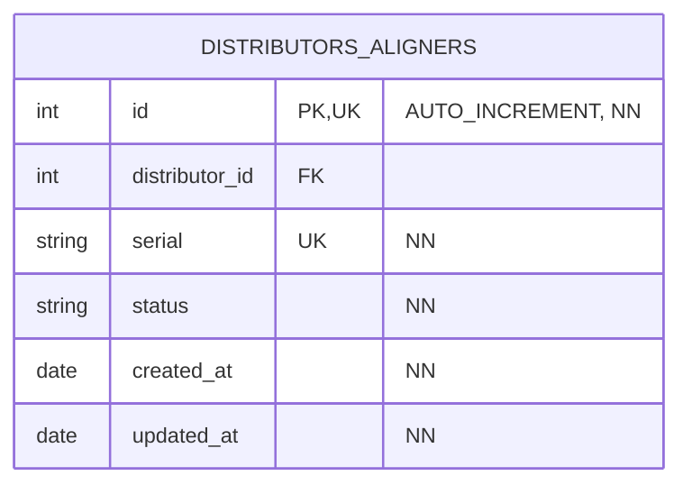

<div class="page" />

### CONTACTS

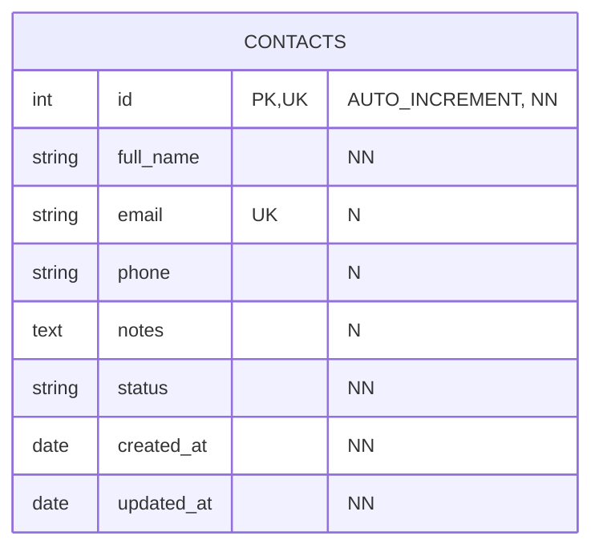

<div class="page" />

### DISTRIBUTORS LISTS

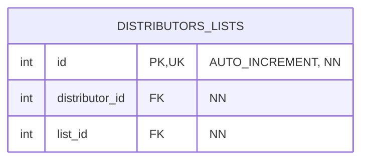

<div class="page" />

### LISTS

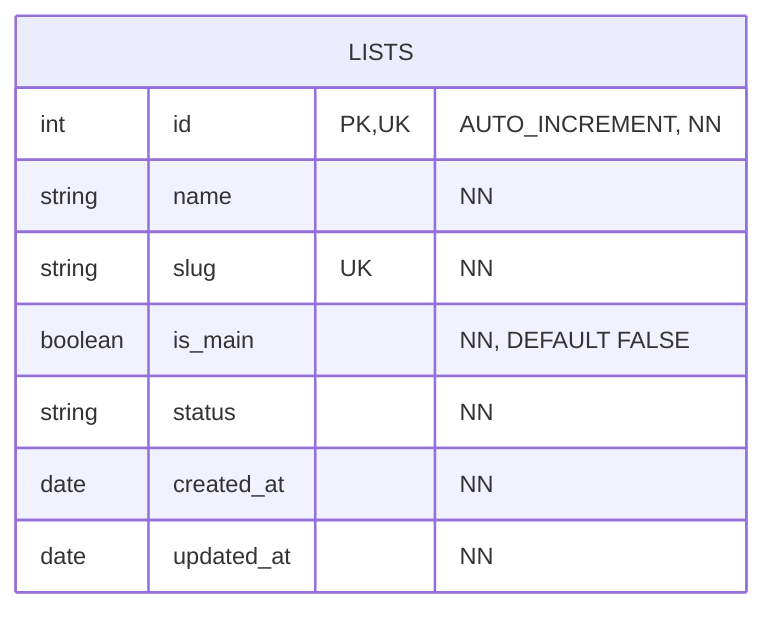

<div class="page" />

### USERS LISTS

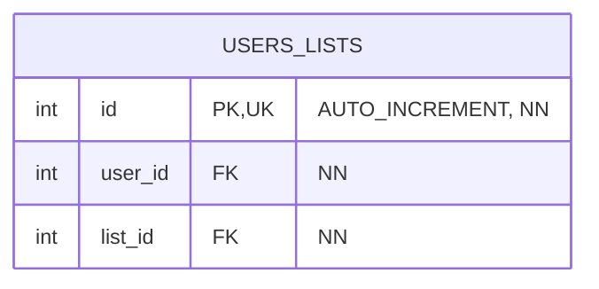

<div class="page" />

### CLIENTS

```mermaid
%%{init: {'theme': 'default', 'themeVariables': { 'fontSize': '12px', 'entityPadding': '5' }}}%%
erDiagram
    CLIENTS {
        int id PK, UK "AUTO_INCREMENT, NN"
        int distributor_id FK "NN"
        string name "NN"
        string phone "NN"
        string status "NN"
        date created_at "NN"
        date updated_at "NN"
    }
```

### USERS

```mermaid
%%{init: {'theme': 'default', 'themeVariables': { 'fontSize': '12px', 'entityPadding': '5' }}}%%
erDiagram
    USERS {
        int id PK, UK "AUTO_INCREMENT, NN"
        string full_name "NN"
        string username UK "NN"
        string email UK "NN"
        string role "NN"
        string password "NN"
        string status "NN"
        date created_at "NN"
        date updated_at "NN"
    }
```

<div class="page" />

### USERS GROUPS

```mermaid
%%{init: {'theme': 'default', 'themeVariables': { 'fontSize': '12px', 'entityPadding': '5' }}}%%
erDiagram
    USERS_GROUPS {
        int id PK, UK "AUTO_INCREMENT, NN"
        int user_id FK "NN"
        int group_id FK "NN"
    }
```

<div class="page" />

### GROUPS

```mermaid
%%{init: {'theme': 'default', 'themeVariables': { 'fontSize': '12px', 'entityPadding': '5' }}}%%
erDiagram
    GROUPS {
        int id PK, UK "AUTO_INCREMENT, NN"
        int distributor_id FK "NN"
        string name UK "NN"
        string status "NN"
        date created_at "NN"
        date updated_at "NN"
    }
```

<div class="page" />

### PERMISSIONS

```mermaid
%%{init: {'theme': 'default', 'themeVariables': { 'fontSize': '12px', 'entityPadding': '5' }}}%%
erDiagram
    PERMISSIONS {
        int id PK, UK "AUTO_INCREMENT, NN"
        int group_id FK "NN"
        int module_id FK "NN"
        boolean read "NN"
        boolean create "NN"
        boolean delete "NN"
        boolean update "NN"
        string status "NN"
        date created_at "NN"
        date updated_at "NN"
    }
```

<div class="page" />

### MODULES

```mermaid
%%{init: {'theme': 'default', 'themeVariables': { 'fontSize': '12px', 'entityPadding': '5' }}}%%
erDiagram
    MODULES {
        int id PK, UK "AUTO_INCREMENT, NN"
        string name "NN"
        string status "NN"
        date created_at "NN"
        date updated_at "NN"
    }
```

<div class="page" />

### BRANDS

```mermaid
%%{init: {'theme': 'default', 'themeVariables': { 'fontSize': '12px', 'entityPadding': '5' }}}%%
erDiagram
    BRANDS {
        int id PK, UK "AUTO_INCREMENT, NN"
        string name "NN"
        string slug "NN"
        string status "NN"
        date created_at "NN"
        date updated_at "NN"
    }
```

<div class="page" />

### CATEGORIES

```mermaid
%%{init: {'theme': 'default', 'themeVariables': { 'fontSize': '12px', 'entityPadding': '5' }}}%%
erDiagram
    CATEGORIES {
        int id PK, UK "AUTO_INCREMENT, NN"
        string name "NN"
        string slug "NN"
        string status "NN"
        date created_at "NN"
        date updated_at "NN"
    }
```

<div class="page" />

### EQUIPMENTS

```mermaid
%%{init: {'theme': 'default', 'themeVariables': { 'fontSize': '12px', 'entityPadding': '5' }}}%%
erDiagram
    EQUIPMENTS {
        int id PK, UK "AUTO_INCREMENT, NN"
        int brand_id FK "NN"
        int category_id FK "NN"
        string model "NN"
        string reference "NN"
        string status "NN"
        date created_at "NN"
        date updated_at "NN"
    }
```

<div class="page" />

### PARTS

```mermaid
%%{init: {'theme': 'default', 'themeVariables': { 'fontSize': '12px', 'entityPadding': '5' }}}%%
erDiagram
    PARTS {
        int id PK, UK "AUTO_INCREMENT, NN"
        int equipment_id FK "NN"
        string serial "NN"
        string description "NN"
        string status "NN"
        date created_at "NN"
        date updated_at "NN"
    }
```

<div class="page" />

### INSTALLATIONS

```mermaid
%%{init: {'theme': 'default', 'themeVariables': { 'fontSize': '12px', 'entityPadding': '5' }}}%%
erDiagram
    INSTALLATIONS {
        int id PK, UK "AUTO_INCREMENT, NN"
        int equipment_id FK "NN"
        int distributor_id FK "NN"
        int site_distributor_id FK "NN"
        int client_id FK "NN"
        int site_client_id FK "NN"
        int user_id FK "NN"
        string serial "NN"
        date installed_date "NN"
        string status "NN"
        date created_at "NN"
        date updated_at "NN"
    }
```

<div class="page" />

### REASONS

```mermaid
%%{init: {'theme': 'default', 'themeVariables': { 'fontSize': '12px', 'entityPadding': '5' }}}%%
erDiagram
    REASONS {
        int id PK, UK "AUTO_INCREMENT, NN"
        int category_id FK "NN"
        string name "NN"
        string slug "NN"
        string description "NN"
        string status "NN"
        date created_at "NN"
        date updated_at "NN"
    }
```

<div class="page" />

### WARRANTIES

```mermaid
%%{init: {'theme': 'default', 'themeVariables': { 'fontSize': '12px', 'entityPadding': '5' }}}%%
erDiagram
    WARRANTIES {
        int id PK, UK "AUTO_INCREMENT, NN"
        int distributor_id FK "NN"
        int site_id FK "NN"
        int equipment_id FK "NN"
        int user_approval_id "N"
        date sale_date "NN"
        string invoice "NN"
        string ship_to "NN"
        string problem "NN"
        string solution "NN"
        date received_at "N"
        string status "NN"
        date created_at "NN"
        date updated_at "NN"
    }
```

<div class="page" />

### INSTALLATIONS FILES

```mermaid
%%{init: {'theme': 'default', 'themeVariables': { 'fontSize': '12px', 'entityPadding': '5' }}}%%
erDiagram
    INSTALLATIONS_FILES {
        int id PK, UK "AUTO_INCREMENT, NN"
        int installation_id FK "NN"
        string original_name "NN"
        string path "NN"
        string file_type "NN, [FORMAT, SERIAL, EVIDENCES]"
        string status "NN"
        date created_at "NN"
        date updated_at "NN"
    }
```

<div class="page" />

### SPECIFICATIONS

```mermaid
%%{init: {'theme': 'default', 'themeVariables': { 'fontSize': '12px', 'entityPadding': '5' }}}%%
erDiagram
    SPECIFICATIONS {
        int id PK, UK "AUTO_INCREMENT, NN"
        int equipment_id FK "NN"
        string name "NN"
        string value "NN"
        string type "NN"
        string status "NN"
        date created_at "NN"
        date updated_at "NN"
    }
```

<div class="page" />

### EQUIPMENTS FILES

```mermaid
%%{init: {'theme': 'default', 'themeVariables': { 'fontSize': '12px', 'entityPadding': '5' }}}%%
erDiagram
    EQUIPMENTS_FILES {
        int id PK, UK "AUTO_INCREMENT, NN"
        int equipment_id FK "NN"
        string original_name "NN"
        string hash_name "NN"
        string path "NN"
        string extension "NN"
        string mimetype "NN"
        string size "NN"
        boolean is_main "NN"
        integer sort_order "NN"
        string status "NN"
        date created_at "NN"
        date updated_at "NN"
    }
```

<div class="page" />

### MANUALS TYPES

```mermaid
%%{init: {'theme': 'default', 'themeVariables': { 'fontSize': '12px', 'entityPadding': '5' }}}%%
erDiagram
    MANUALS_TYPES {
        int id PK, UK "AUTO_INCREMENT, NN"
        string name "NN"
        string slug "NN"
        date created_at "NN"
        date updated_at "NN"
    }
```

<div class="page" />

### MANUALS

```mermaid
%%{init: {'theme': 'default', 'themeVariables': { 'fontSize': '12px', 'entityPadding': '5' }}}%%
erDiagram
    MANUALS {
        int id PK, UK "AUTO_INCREMENT, NN"
        int equipment_id FK "NN"
        int manual_type_id FK "NN"
        string title "N"
        string description "N"
        date created_at "NN"
        date updated_at "NN"
    }
```

<div class="page" />

### MANUALS FILES

```mermaid
%%{init: {'theme': 'default', 'themeVariables': { 'fontSize': '12px', 'entityPadding': '5' }}}%%
erDiagram
    MANUALS_FILES {
        int id PK, UK "AUTO_INCREMENT, NN"
        int manual_id FK "NN"
        string original_name "NN"
        string hash_name "NN"
        string path "NN"
        string extension "NN"
        string mimetype "NN"
        string size "NN"
        string status "NN"
        date created_at "NN"
        date updated_at "NN"
    }
```

<div class="page" />

### WARRANTIES REASONS

```mermaid
%%{init: {'theme': 'default', 'themeVariables': { 'fontSize': '12px', 'entityPadding': '5' }}}%%
erDiagram
    WARRANTIES_REASONS {
        int id PK, UK "AUTO_INCREMENT, NN"
        int warranty_id FK "NN"
        int reason_id FK "NN"
    }
```

<div class="page" />

### WARRANTIES WCOS

```mermaid
%%{init: {'theme': 'default', 'themeVariables': { 'fontSize': '12px', 'entityPadding': '5' }}}%%
erDiagram
    WARRANTIES_WCOS {
        int id PK, UK "AUTO_INCREMENT, NN"
        int code "NN"
        int year "NN"
    }
```

<div class="page" />

### WARRANTIES FILES

```mermaid
%%{init: {'theme': 'default', 'themeVariables': { 'fontSize': '12px', 'entityPadding': '5' }}}%%
erDiagram
    WARRANTIES_FILES {
        int id PK, UK "AUTO_INCREMENT, NN"
        int warranty_id FK "NN"
        string original_name "NN"
        string path "NN"
        string status "NN"
        date created_at "NN"
        date updated_at "NN"
    }
```
